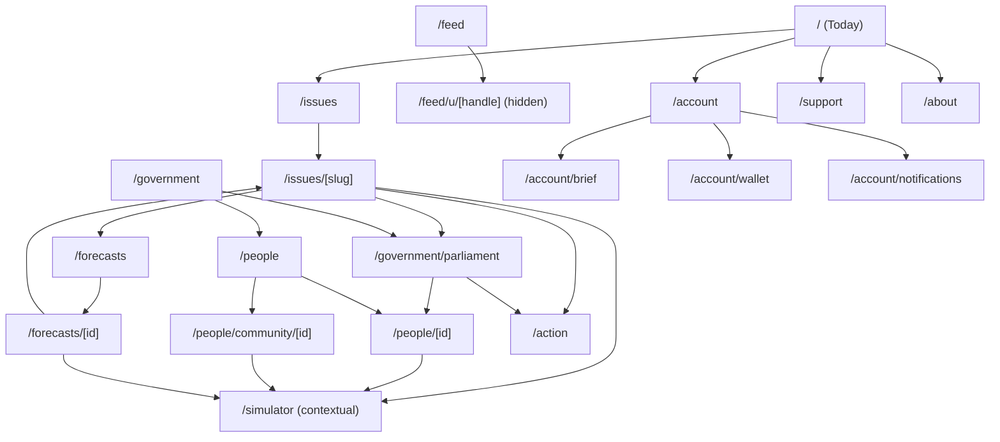

# Stickee — Proposed Route Tree

Read-only design document. No routes were created, renamed, or modified by this audit. This is the target information architecture the `PAGE_REFACTOR_ROADMAP.md` batches work toward — not a route tree to adopt in one step.

## Recommended final navigation (primary, max 5)

Per `INFORMATION_ARCHITECTURE_AUDIT.md`'s navigation audit, **Option C (Hybrid)** is recommended:

| Order | Label | Route |
|---|---|---|
| 1 | Today | `/` |
| 2 | Issues | `/issues` |
| 3 | Government | `/government` |
| 4 | Forecasts | `/forecasts` |
| 5 | Support | `/support` (or About, if legal content is written first) |

People, Parliament, Simulator, Feed, Campaigns, Account, and Elections are all real and kept — they become sub-destinations reachable from these five, plus the persistent header (auth/account, notifications) and footer, rather than competing primary items. This directly resolves the audit's #6 confusion point (three inconsistent nav registries) by making one registry the source of truth for Navbar, BottomNav, and the Command Palette alike — a mechanical consistency fix independent of which nav option is chosen.

## Proposed route tree

```
/                              Today — national briefing, 2 primary CTAs
/issues                        Unified Issues & Decisions list (filterable by type/status/level)
/issues/[slug]                 One editorial page per bill/issue/decision (merged detail page)

/government                    Government section landing (chamber snapshot + top MPs)
/government/parliament         Chamber views, real MP votes, real bill-pressure campaign actions
/government/parliament/[billId]  (optional) bill-specific parliamentary record, linked from /issues/[slug]

/people                        People landing — MP roster (primary) + community leaders (labeled section)
/people/[id]                   Real MP profile (real vote record wired in)
/people/community/[id]         Community-nominated leader profile (kept from /leaders/[id])

/forecasts                     Slimmed market board + featured forecast (staking core only)
/forecasts/[id]                NEW — canonical per-market detail page (does not exist today)

/simulator                     Kept as a route (deep-linkable, shareable) but removed from primary nav;
                                entry points remain contextual ("Explore scenarios" on Issues/People/Forecasts)

/action                        Real "take action" surface — the CampaignModal mechanic promoted to a
                                first-class linked destination (email MP, join bill-pressure campaigns)
/action/campaigns/[id]          (optional) if campaigns ever get independent tracking beyond a single bill

/feed                          Kept, re-scoped copy (civic alert stream first, community second)
/feed/u/[handle]                Civic-voice profiles nested under Feed (was /u/[handle]) — hidden until real

/account                       Profile — genuinely auth-gated, real data only
/account/brief                 Personalisation preferences (was /onboarding's static content + the modal's data)
/account/wallet                Wallet/portfolio (moved out of /forecasts)
/account/notifications         Notifications (was /notifications, bug-fixed demo fallback)

/support                       Donate landing (was /donate)
/support/success               (was /donate/success)
/support/cancel                (was /donate/cancel)

/auth/sign-in
/auth/sign-up
/auth/forgot-password
/auth/reset-password
/auth/callback

/admin/*                       Unchanged — internal, gated, out of scope for this IA work

/about                         NEW — mission, methodology, and a home for legal content
/privacy, /terms               NEW — required before the existing CookieBanner's claims are truthful
```

**Not in the proposed tree, and why:**
- `/decisions`, `/government` (as a bare redirect) — merged/retired, see Consolidation plan.
- `/leaders` — replaced by `/people`.
- `/predictions` — replaced by `/forecasts`.
- `/leaderboard` — hidden until real; if/when reinstated, proposed as a tab within `/forecasts` or `/account`, not a standalone route.
- `/campaigns` (the standalone fake-mechanic page) — retired in favor of `/action`, which wraps the *real* mechanic.
- `/onboarding` (the static page) — folded into `/account/brief`.

## Purpose of every future page

| Route | Purpose |
|---|---|
| `/` | Answer "what changed and what should I do" in one screen, truthfully labeled. |
| `/issues` | The single list of everything government is considering or has decided. |
| `/issues/[slug]` | Everything a reader needs to understand one issue: context, real evidence links, one real prediction affordance, one real action. |
| `/government` | Orient a visitor to Stickee's evidence layer — chamber, votes, people — before they dive into Parliament or People specifically. |
| `/government/parliament` | The parliamentary record: chamber composition, real votes, real bill-pressure actions. |
| `/people` | Who represents you (MPs) and who's stepping up (community leaders) — one page, two labeled groups. |
| `/people/[id]` | A real MP's real record. |
| `/people/community/[id]` | A community-nominated leader's profile and support pledge. |
| `/forecasts` | What the crowd expects to happen, and how confident it is. |
| `/forecasts/[id]` | Everything about one specific forecast: question, probability, evidence, stake action. |
| `/simulator` | Test a different choice and see a clearly-labeled modeled consequence — reached contextually. |
| `/action` | Turn an opinion into a real, counted civic action. |
| `/feed` | A dated, sourced stream of what just happened in Australian civic life. |
| `/feed/u/[handle]` | A civic-voice contributor's profile and posts (once real). |
| `/account` | My real settings, my real activity. |
| `/account/brief` | My electorate, my top issues — what personalises my Stickee. |
| `/account/wallet` | My real forecast positions and points. |
| `/account/notifications` | What I personally need to know or act on. |
| `/support`, `/support/success`, `/support/cancel` | Help fund Stickee. |
| `/about`, `/privacy`, `/terms` | What Stickee is, how it works, and its legal commitments. |

## Old → new route mapping

| Old route | New route | Merge/rename/remove |
|---|---|---|
| `/` | `/` | Keep, content simplified |
| `/issues` | `/issues` | Keep, absorbs Decisions |
| `/issue/[id]` | `/issues/[slug]` | Renamed, restructured (widgets → links) |
| `/decisions` | `/issues` (filtered) | Merged |
| `/government` | `/government` | Repurposed from bare redirect into a real section landing |
| `/parliament` | `/government/parliament` | Renamed, bill-list section removed (now links to `/issues`) |
| `/leaders` | `/people` | Renamed, restructured (MP table becomes primary, mock scorecard block retired) |
| `/leaders/[id]` | `/people/community/[id]` | Renamed |
| `/mp/[id]` | `/people/[id]` | Renamed, real vote data wired in |
| `/u/[handle]` | `/feed/u/[handle]` | Renamed, hidden until real |
| `/predictions` | `/forecasts` | Renamed, slimmed (wallet/leaderboard/election-pulse moved out) |
| *(none — gap)* | `/forecasts/[id]` | New — did not exist before |
| `/simulator` | `/simulator` | Kept as a route, removed from primary nav |
| `/leaderboard` | *(hidden)*, later `/account` or `/forecasts` tab | Hidden until real |
| `/impact` | `/impact` (or folded into `/`) | Kept, copy fixed |
| `/campaigns` | `/action` | Replaced by the real mechanic |
| `/feed` | `/feed` | Kept, re-scoped copy |
| `/notifications` | `/account/notifications` | Renamed, demo-fallback bug fixed |
| `/profile` | `/account` | Renamed, made genuinely auth-gated |
| `/onboarding` | `/account/brief` | Merged into account/personalisation |
| `/donate` | `/support` | Renamed (optional/lower priority) |
| `/donate/success` | `/support/success` | Renamed |
| `/donate/cancel` | `/support/cancel` | Renamed |
| `/auth/*` | `/auth/*` | Unchanged |
| `/admin/*` | `/admin/*` | Unchanged |
| *(none — gap)* | `/about`, `/privacy`, `/terms` | New — required for `CookieBanner` to be truthful |

## Mermaid site map



## Notes on adoption

This tree is the *target*, not a next step. `PAGE_REFACTOR_ROADMAP.md` sequences the path from the current tree to this one in dependency-ordered batches, several of which (Simulator's nav-slot removal, home-page link fixes, notification demo-fallback fix) can land well before the larger Issues/Decisions or People merges that depend on data-model decisions this audit deliberately leaves to the owner.
