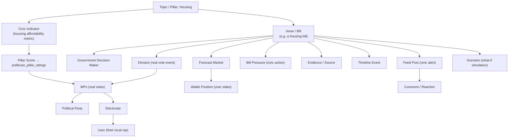
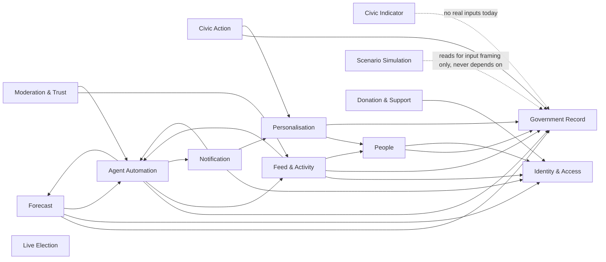

Governed by [`AGENTS.md`](../../AGENTS.md). Companion to [`DOMAIN_MODEL.md`](DOMAIN_MODEL.md) — that document defines each object; this one shows how they connect, and where connections are currently broken or missing. Documentation only, no code changed.

# Stickee — Relationship Graph

## The intended experience: one connected civic database

A reader following one topic should be able to move outward through every related object without ever feeling like they left into a different app. Using Housing as a worked example, in the direction the platform's mission implies:

**Every arrow above is a relationship a reader could plausibly want to follow.** The table below states, per arrow, whether it's real today, mocked, or simply doesn't exist yet — this is the actual current state, not the aspiration.

| From → To | Real today? | Notes |
|---|---|---|
| Topic → Civic Indicator | **No** | `pillar_metrics` unused; mock only. |
| Topic → Issue | Partial | Issues aren't tagged by pillar/topic in a structured way today — filtering is by status/level, not by civic pillar. |
| Issue → Government Decision Maker | Mock only | `DecisionMaker` exists only inside `mock-government-data.ts`. |
| Issue → Division | **Yes** | Real, via TheyVoteForYou sync. |
| Division → MP | **Yes** | Real (`member_votes`). |
| Issue → Forecast Market | **Yes** (for bills with a market) | `issue_markets`, real. |
| Forecast Market → Wallet Position | **Yes** | Real, verified. |
| Issue → Bill Pressure | **Yes** | Real (`bill_pressures`). |
| Issue → Evidence/Source | **No** | `source_url` column exists, unpopulated for the claims that most need it. |
| Issue → Timeline Event | Mock only | No real `issue_timeline_events` table. |
| MP → Party | **Yes** | Real (synced). |
| MP → Electorate | **Yes** (identity) | Real for the MP side; the reverse (User → their electorate) is fake. |
| Electorate → User | **No (fake)** | `/api/electorate-lookup` is hash-based, not geographic. |
| Issue → Feed Post | **Yes** | Real, when `parliament-watcher`/`bill-stage-tracker` fire. |
| Feed Post → Comment/Reaction | **Yes** | Real. |
| Issue → Scenario | **Yes, but one-way and non-persistent** | The simulator bridge can build a scenario *from* an issue; nothing about a scenario writes back to the issue. This is correct isolation, not a defect. |
| Civic Indicator → Pillar Score → MP | **No** | Entire chain unused; `politician_pillar_ratings` has zero application-code references. |

**Reading this table is the actual point of this document.** Roughly half of the "one connected civic database" arrows the mission implies are real today. The other half are either mocked, one-directional stubs, or simply absent. Closing these gaps — not adding new object types — is the highest-leverage way to make Stickee feel like the connected system the mission describes.

---

## System dependency graph

This is the systems-level view (see `STICKEE_SYSTEM_ARCHITECTURE.md` for full system definitions), showing which systems currently depend on which. An arrow means "reads from" or "requires data produced by."

**Notes on this graph:**
- `Identity & Access`, `Government Record`, and `Live Election` have no upstream dependencies on other Stickee systems — correctly, since they're the platform's foundational/source-of-truth layers.
- `Agent Automation` sits in the middle of the graph almost everywhere, which is expected for a background-compute system — but it also means a defect in Agent Automation (e.g. the `mp-scorecard` fragile join) has a wide, quiet blast radius across Feed, Notification, and derived scores. Treat it with the same seriousness as a shared library, not as a peripheral cron job.
- `Civic Indicator`'s dotted line to `Government Record` is aspirational, not real — there is currently no data flow into the pillar system from anything. This graph edge existing only as a dotted line *is* the finding.
- `Scenario Simulation`'s relationship to every other system is deliberately read-only and one-directional (input framing), never a true dependency — this isolation is a design strength worth protecting explicitly whenever the simulator is extended.

---

## What "exploring one connected database" should feel like, concretely

A reader on an Issue page should be able to reach, without leaving the conceptual thread: the real vote that will decide it (Government Record), whether the crowd expects it to pass (Forecast), what they personally can do about it (Civic Action), who's already reacted to it (Feed), what's happened to it over time (Timeline Event — currently missing), and what a different policy choice might have produced instead (Scenario Simulation). Today most of these links exist as separate pages a user has to already know to visit, not as inline cross-links off the Issue object itself. `PAGE_COMPOSITION_GUIDE.md` addresses this at the page-composition level; this document names it at the data level: the links are missing because the underlying relationship (Issue → Timeline Event, Issue → Evidence) is itself mock or absent, not just unlinked in the UI.
