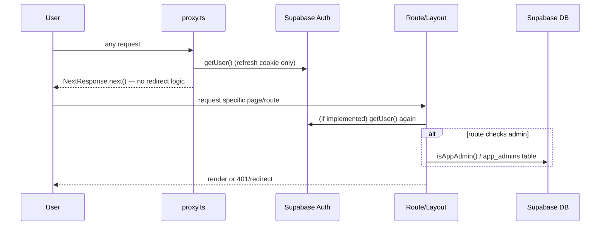
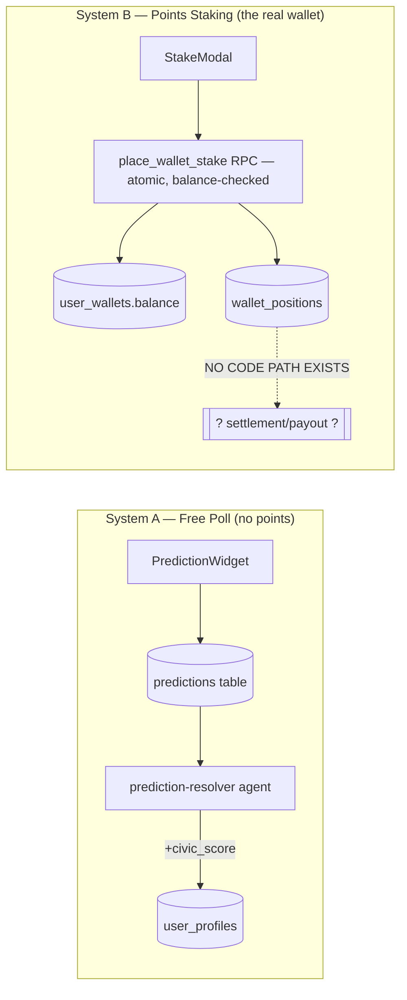

# Stickee — System Architecture Audit

Read-only architecture review. No application code was modified to produce this document.

## 1. Plain-English overview

Stickee is a Next.js 16 (App Router, React 19) web app backed by Supabase (Postgres + Auth). It has three distinct data personalities that are not clearly separated from each other:

1. **A real, working civic-data platform** — Supabase auth, an admin console, Stripe donations, a Postgres-backed points wallet with an atomic staking RPC, a bill-pressure/campaign system, and real syncs from the Australian TheyVoteForYou API and a live AEC election-tally scraper.
2. **A demo/mock content layer** — five-plus `mock-*.ts` files (politicians, parties, votes, markets, senate composition, simulator scenarios, civic scores, government decisions, feed posts, leader nominations) that are **actively imported into live, public-facing pages**, not just used as fixtures or fallbacks in tests. There are no tests, so these files effectively *are* the test fixtures, running in production.
3. **A background "agent" system** — seven deterministic (non-LLM) cron jobs that read/write the real database, triggered by Vercel Cron against a secret-gated API route.

These three layers are interleaved page-by-page rather than cleanly separated: some routes are 100% real (admin, auth, donations, sync endpoints), some are 100% mock (`/leaderboard`, `/notifications`, `/profile`, `/leaders/[id]`, `/u/[handle]`), and several are hybrid — "try Supabase first, fall back to mock data if empty" (`/issues`, `/issue/[id]`, `/predictions`, `/parliament`, `/feed`). A user cannot tell which mode a given page is in from the UI.

## 2. Application layers

```mermaid
flowchart TB
    subgraph Client["Browser (Client Components)"]
        UI[React 19 UI — feed, markets, profile, admin console]
    end
    subgraph Edge["Edge / Proxy"]
        Proxy[proxy.ts — session-cookie refresh only, NO route gating]
    end
    subgraph Server["Next.js Server (App Router)"]
        Pages[Server Components / page.tsx]
        API[Route Handlers — /api/**]
        Actions[Server Actions — admin, auth, onboarding]
    end
    subgraph Data["Data Sources"]
        Supabase[(Supabase Postgres + Auth)]
        Mock[/mock-*.ts static fixtures/]
        TVFY[TheyVoteForYou API]
        AEC[AEC Tally Room — live scrape]
        Stripe[Stripe Checkout + Webhooks]
    end
    subgraph Cron["Vercel Cron (9 schedules)"]
        Agents[/api/agents/[id] — 7 agents/]
        Sync[/api/sync/members, /api/sync/divisions/]
    end

    UI --> Proxy --> Pages
    UI -->|fetch| API
    Pages --> Supabase
    Pages -.fallback.-> Mock
    API --> Supabase
    API --> Stripe
    Actions --> Supabase
    Cron -->|x-sync-secret / Bearer CRON_SECRET| Agents
    Cron --> Sync
    Sync --> TVFY --> Supabase
    Agents --> Supabase
    Pages --> AEC
```

**Server/client boundaries:** Roughly half of top-level pages are Server Components (admin/*, donate/*, auth/callback, issue/[id], issues, mp/[id], leaders/[id], parliament, predictions, government, impact, home) and half are Client Components (feed, leaderboard, notifications, profile, simulator, campaigns, u/[handle], leaders index, sign-in/up). The split looks organic (driven by whether a page needs interactivity) rather than by a deliberate data-boundary policy — several Client Component pages (`/profile`, `/leaderboard`, `/notifications`) fetch nothing server-side at all and instead read `localStorage` or hardcoded constants, which is why they're pure demo pages today.

## 3. Authentication flow



Every route/layout is individually responsible for its own auth check — `proxy.ts` (the Next.js 16 rename of `middleware.ts`) does nothing but keep the Supabase session cookie fresh. In practice, the routes that need protection (admin actions, mutating API routes) do implement real server-side checks (see `SECURITY_AND_PERMISSIONS_AUDIT.md`), but the **architecture has no fail-closed backstop** — a new route added without an explicit `getUser()`/`isAppAdmin()` call is unauthenticated by default, and there is no test or lint rule that would catch that omission.

Note: the repo's working tree currently has `middleware.ts` **deleted** and an untracked `proxy.ts` added — this is an in-progress, uncommitted migration to Next.js 16's renamed convention (per this repo's own `AGENTS.md` warning to read `node_modules/next/dist/docs/` before writing routing code). This should be committed deliberately, not left as an uncommitted working-tree diff.

## 4. Prediction placement flow (as it actually works)

There are **two separate, non-interacting prediction systems** sharing the same UI vocabulary:



- **System A** (`predictions` table) is a simple yes/no civic poll. It **is** resolved, by the `prediction-resolver` cron agent, which awards `civic_score` points based on issue outcome.
- **System B** (`user_wallets` / `wallet_positions`, driven by the `place_wallet_stake` Postgres RPC) is the actual virtual-points wagering system users interact with via `StakeModal`. The RPC deduction itself is well-built (single atomic conditional `UPDATE ... WHERE balance >= p_amount`, so no overspend/race condition on the debit side). **But no code anywhere in the repository ever resolves a `wallet_positions` row or credits a payout back to `user_wallets.balance`.** Points can leave a wallet via staking; nothing brings them back. See `MARKET_ENGINE_AUDIT.md` for full detail — this is the single largest functional gap in the product relative to its stated purpose.

## 5. Market settlement flow

There isn't one, for the system that matters (System B above). What exists:

- `prediction-resolver` agent resolves System A's `predictions`/`issues` records and posts a "resolution" feed post, keyed off `issues.status` (`active|passed|rejected`), with idempotency via a synthetic feed-post ID rather than a dedicated settlement ledger.
- No admin UI, API route, or agent references `wallet_positions.status` transitions from `open` to `won`/`lost`, and no code writes to `wallet_positions.payout` (a column that exists in the schema but is never populated).
- `issue_markets.status` (`active|resolved-yes|resolved-no`) is likewise never transitioned by any code path found.

## 6. Third-party services

| Service | Purpose | Integration quality |
|---|---|---|
| Supabase (Postgres + Auth) | Primary datastore, auth, RLS | Core, well-used |
| Stripe | One-off/recurring donations | Real, with signature-verified webhooks (`timingSafeEqual`) and server-clamped amounts |
| TheyVoteForYou API | Real AU federal parliament vote data | Real, cron-synced daily |
| AEC Tally Room (scrape) | Live election results | Real, live-fetched with disclosure text distinguishing Stickee's summary from an official AEC declaration — the one place in the codebase that models source trust correctly |
| Vercel Cron | Schedules 9 jobs (2 syncs + 7 agents) | Real, secret-gated |

No LLM/generative-AI service is integrated anywhere in the audited code — all seven "agents" are deterministic template-string generators over real DB rows (confirmed by direct code read, not inferred from naming).

## 7. Major technical debt

1. **Two incompatible mental models of "prediction market" coexist in the same codebase** (free poll vs. points-staking) with overlapping UI language, and only one of the two is resolvable. This is the most consequential architectural debt — see Market Engine Audit.
2. **No centralized route-protection layer.** `proxy.ts` is cosmetic (session refresh only); every route reinvents its own auth check. Works today by discipline, not by design.
3. **Mock data is a first-class, load-bearing part of production**, not a fallback-only or dev-only layer. `mock-data.ts`, `mock-market-data.ts`, `mock-senate-data.ts`, `mock-simulator-data.ts`, plus `mock-government-data.ts`, `mock-civic-data.ts`, `mock-feed-data.ts`, and `mock-leaders-data.ts` are imported directly by live pages with no environment gate distinguishing "demo mode" from "production mode."
4. **`migrations_bundle.sql` is stale** — it is missing the tables introduced in migration 013 (`agents`, `agent_runs`, `feed_posts`, `feed_impressions`), so running the bundle against a fresh database fails. The numbered migration files are the only reliable source of truth for schema history; the bundle should either be regenerated or removed to avoid misleading a new contractor who reaches for it as a "one-shot setup" script.
5. **Duplicate/dead civic-scoring schema.** Migration 003 defines `pillar_metrics`, `pillar_scores`, and `politician_pillar_ratings` — a structured, source-attributed scoring model — but it is never referenced by any application code. Meanwhile the score users actually see (`calculateStickeeScore()` in `mock-data.ts`) is a different, much weaker, mock-data-driven calculation. The better-designed system is dormant; the live one is fabricated. See Data & Content Audit.
6. **No test suite, no CI, no lint config.** `tsc --noEmit` and `next build` both pass cleanly today, which is good, but nothing prevents regressions on the next change, and nothing enforces code style for outsourced contributions.
7. **Uncommitted working tree.** At the time of this audit, the repo has ~48 modified files and ~15 new directories/files sitting uncommitted (including the `middleware.ts` → `proxy.ts` migration and most of the wallet/agents/admin system). This audit was performed against the working tree, not a clean commit — treat findings here as describing the *current* state on disk, which has not yet been captured in git history.

## 8. Where the architecture is clean vs. risky

**Clean / well-built:**
- The `place_wallet_stake` RPC (atomic balance debit, race-condition-safe).
- Admin authorization pattern for *mutations* (every admin server action independently calls `requireAdminUserId()`).
- Stripe webhook verification and checkout amount clamping.
- RLS is enabled on essentially every user-data table, with one significant exception (see Security audit).
- TheyVoteForYou sync and AEC live-scrape integrations are genuinely real, not stubs.

**Unnecessarily complicated / tightly coupled:**
- Feed ranking (`src/lib/feed/ranker.ts`) mixes real Supabase rows with `mock-feed-data.ts` seeding and silently drops the `source_agent_id` column that would let the UI disclose bot authorship — the complexity is in the *wrong* place (hiding provenance) rather than the right place (ranking quality).
- `live-parliament.ts` merges real TVFY member rows with mock seat-index/score data purely for chamber-visualization layout, which couples a real data pipeline to a mock display fixture.

**Difficult to outsource safely today:**
- Anything touching `user_wallets`/`wallet_positions`/market resolution — the mental model is incomplete (no settlement path exists), so a contractor cannot safely extend it without first deciding, with the owner, what the correct lifecycle actually is.
- Anything touching MP/leader scoring — the methodology claim shown to users doesn't match the code, so a contractor fixing a "bug" here could either "fix" it to match false marketing copy or correctly break the copy; this needs an owner decision first.

**Likely to cause production incidents:**
- No error monitoring — a cron agent failing silently (e.g., the daily bonus job's lost-update race under concurrent staking) would not page anyone.
- The uncommitted `proxy.ts`/`middleware.ts` transition, if not finished and committed correctly, could ship inconsistent auth-cookie behavior.
